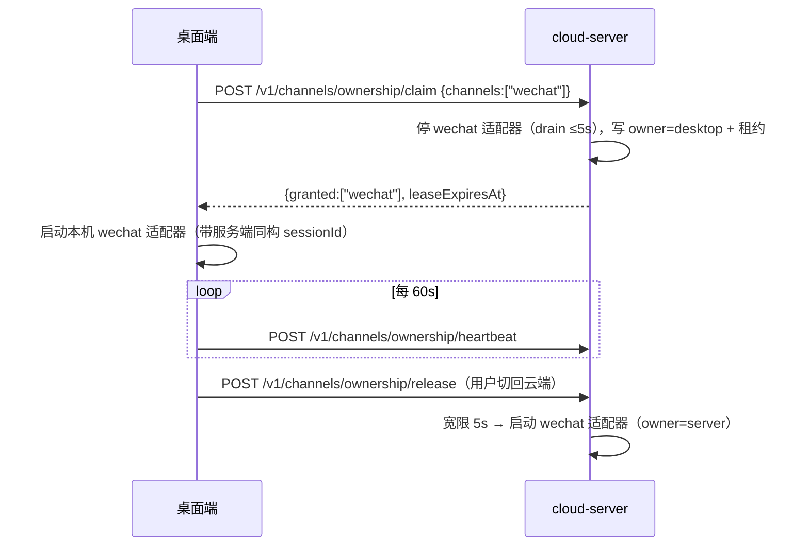

# 服务端渠道 24/7（云端昔涟 Phase 2 · 渠道批）设计

> **状态**：**已实施**（2026-10-05，分支 `feat/server-channel`）——渠道批五轨 + 收口轨已落地；实现与 PR 依据仍以本文为准。
> **收口说明（2026-10-05 阶段 8）**：已知缺口 = SILK 语音仍为 `ISilkCodec` 占位 + 文本降级（§4.2 阶段 7 未落地）；
> 服务端自主主动消息调度未做（依赖 IKJK2O，§5.4 Q3）；真机冒烟待人工执行（清单见 `dotnet/cloud-server/README.md`「真机冒烟清单」）。
> **R1 评审收口（2026-10-05）**：飞书出站缺省 `receive_id_type=chat_id`（§6.3）、`E_CHANNEL_UNSUPPORTED`（§5.2）、
> preferServer 已实现（§5.5）、QQ 附件-only 拦截文案（§7.2/Q7）等已并入；`healthz.channels` 与 RSS>380MB 告警
> 本批未实现（§3.5/§5.7/§8.3，后续批次）；fixtures 62 例。
> **R2 评审收口（2026-10-05）**：契约 runner 布尔比较 + 负向探针（§8.1）、归属宽限任务持锁复查与 sweep 跳过宽限期（§5.3）、preferServer 空集交回（§5.5）、`status.detail.owner` 按归属覆盖（§2.2）、QQ 确定性失败不重试（§7.2）、QQ/微信畸形输入按 JS 语义对齐（§2.2）。
> **R3 评审收口（2026-10-05）**：生命周期锁有界等待与归属启动门闩（§5.1/§5.3）、扫码确认重启受归属约束（§5.3）、QQ 发送限时与错误码清理（§7.2）、微信时间戳越界与飞书同口径（§2.2）、真机清单补明文时间戳确认项（§6.2）。
> **关联**：RFC `docs/design/2026-10-03-cloud-cyrene-rfc.md`（§0.3 阶段范围 / §1 总体架构 / §6 issue 映射）·
> 服务端四形态 `docs/design/2026-10-04-cloud-server-forms.md` · 同步协议 v0
> `docs/specs/2026-10-04-sync-protocol-v0.md` + `fixtures/sync-protocol/` ·
> 桌面渠道运行时 `src/main/channels/**` · issue **IKJK3P / IKJK2P / IKJK2R / IKJK2S / IKJK2T** ·
> 定时任务常驻化 `docs/design/2026-10-05-scheduler-to-dotnet.md`（主动消息调度的近邻批次）。
> **结论先行**：在 `dotnet/cloud-server` 内建一层与桌面 `src/main/channels` **同构**的渠道层
> （`IChannelAdapter` + 消息类型镜像 + fixtures 契约），试点 = **微信 iLink**；
> 渠道消息**进事件流**（v0 `message.append` + `channelSource` presentation），桌面/手机/服务端共享同一历史；
> 归属权用**服务端默认持有 + 桌面租约认领**的唯一调度模型；飞书走 **webhook + 自研最小 REST 客户端**；
> QQ 官方 bot **保留（仅被动回复）**；SILK 语音先设计+占位，按分期落地。单 PR（`feat/server-channel`）交付。

---

## 1. 背景与范围

### 1.1 为什么是「服务端渠道」

Phase 1 已交付：事件库 + `/v1/sync` + 配对令牌 + 服务端生成（`DialogLoop`）+ PWA。
但桌面渠道（`src/main/channels`：微信 iLink / 飞书 / NapCat / QQ 官方 bot）只在 Electron 进程活着时工作——
关机、休眠、退应用即断线。Phase 2 渠道批的目标：把渠道适配器搬到用户的 2G VPS 上 **24/7 常驻**，
同时用「归属权 + 唯一调度」保证同一渠道不会双实例（偷消息 / 重复回复），
并且**现有桌面本地用户体验零变化**（RFC 不变式 1）。

本批不做（保持 Phase 2 其它子批的边界）：记忆 / 心情事件化（IKJK2O）、
服务端自主主动消息生成（依赖前者）、PWA 渠道管理页、多用户/多租户。

### 1.2 issue ↔ 设计 ↔ 验收

| issue | 设计章节 | 交付物 | 验收标准（issue 原文） | 本 PR 证据 |
| --- | --- | --- | --- | --- |
| **IKJK3P** 渠道适配器试点（C#） | §2 §3 | 渠道框架 + 微信 iLink 试点 + 契约 fixtures + VPS 登录/内存方案 | 文本 / 图片链路走通；断线自动重连稳定 | 契约 fixtures 双端全绿；mock iLink e2e（文本/图片）；断线重连单测；真机冒烟豁免（替代证据见 §1.3） |
| **IKJK2P** 归属权与唯一调度 | §5 | 归属声明/交棒/租约 + 主动消息唯一化 + 接管策略 | 模拟两端同时启用，只有一端处理消息与触发调度 | 归属控制面单测（C#）+ TS 归属客户端单测 + mock e2e 双端场景；服务端不可达接管用例 |
| **IKJK2R** 微信 iLink + SILK | §3 §4 | iLink 协议客户端移植 + 登录态过期/扫码投递 + SILK 决策矩阵与分期 | 文本收发稳定；语音端到端（含 ASR/TTS）；凭据过期可人工重登且有告警 | 文本：mock e2e；语音：本 PR 文本优先 + SILK 决策 + `ISilkCodec` 占位与降级文案；ASR/TTS 链路设计冻结，语音实现按分期（§4.1） |
| **IKJK2S** 飞书 | §6 | webhook 事件接收 + REST 发送 + 媒体/转码 + 主动消息 | 文本 / 图片 / 语音在服务端可用；主动消息实测可达 | 决策矩阵（§6.1）；webhook 签名/解密/challenge 单测；文本/图片 mock e2e；语音按 §6.3（ffmpeg 落地即交付，否则显式降级并记入分期）；主动消息走 `POST /v1/channels/{id}/proactive` 幂等投递用例；真机凭据冒烟豁免 |
| **IKJK2T** QQ 官方 bot | §7 | 保留/放弃决策记录 +（保留时）被动回复移植 | 产出保留/放弃决策记录；若保留，被动回复链路通过 | §7.1 决策矩阵与结论；WS/REST 移植 + 被动回复限频/窗口单测；capability 明示 `proactive: false` |

### 1.3 本 PR 分期边界（冻结）

**进入本 PR（P0/P1）**：

1. 渠道框架：`IChannelAdapter` + 消息类型镜像 + `ChannelManager`/`ChannelHostedService` + `ChannelStore` + 控制面 API；
2. 微信 iLink 试点：文本 + 图片（入站下载 + 事件占位文本、出站图片 item）+ 断线重连 + 扫码登录态（二维码投递桌面设置页）；
3. 归属权与唯一调度（IKJK2P 全部三项）：交棒握手、主动消息唯一化（桌面转发）、服务端不可达接管（显式兜底）；
4. 飞书：webhook 文本/图片；语音（Ogg Opus 转码）**若 ffmpeg 镜像落地**则一并交付，否则按 §6.3 占位降级；
5. QQ 官方 bot：被动回复文本（WS + REST）；
6. 契约：`fixtures/channels/` + schema + TS/C# 双端 runner；
7. 冒烟与 CI：`scripts/channel-smoke-test.py`（mock iLink / mock LLM / mock 上游）、C# 渠道 selftest、TS 单测、既有 54/55 项与 PWA e2e 回归。

**延后（本 PR 只留接口/占位）**：

| 项 | 原因 | 占位/退路 |
| --- | --- | --- |
| SILK 语音端到端（iLink 入站 ASR + 出站 TTS→SILK） | .NET 无现成 SILK 包，需 spike（§4.2）；issue 允许「先文本后语音」 | `ISilkCodec` 抽象 + `SilkUnavailableCodec`（文案降级：与桌面 ASR 未配置同口径）；决策矩阵冻结，实现按 §9 阶段 6 |
| 服务端**自主**主动消息调度（桌面离线时定时触发） | 依赖 IKJK2O 记忆/心情事件化与调度器移植 | 本 PR 提供 `POST /v1/channels/{id}/proactive` 投递端点 + 幂等；桌面在线时转发触发（唯一性已达成） |
| 飞书语音若 ffmpeg 未入镜像 | 镜像体积/构建复杂度权衡 | 音频降级为文本提示；`FeishuMediaTranscoder` 接口先冻结 |
| PWA 扫码登录/渠道管理页 | 桌面优先；PWA 复用同一 API 后续增量 | API 从第一天起同时服务桌面与网页（同源 Bearer） |
| 群聊（飞书群 / iLink 群） | 桌面飞书已定私聊优先；群语义复杂（@、白名单） | 服务端同样**仅私聊**；群消息记日志忽略（capability/status 可见） |
| 媒体同步进事件流 | v0 协议无附件载荷（§4 映射决议） | 事件文本带稳定占位符（`[图片]`/`[文件: name]`），媒体留在服务端本地；后续按 v0.x 修订 |

**豁免（真机依赖，CI 不可执行）与替代证据**：

| 豁免项 | 替代证据 |
| --- | --- |
| 微信真机扫码登录 / 收发 | mock iLink HTTP 服务（getupdates/sendmessage/getuploadurl/get_bot_qrcode/get_qrcode_status）全链路 e2e + 二维码 PNG 渲染单测；PR 附**人工冒烟清单**（扫码→收文本→发文本→发图→断网重连→ret=-14 告警）与日志脱敏抽查 |
| 飞书真实 App 凭据 / 事件推送 | 官方加密/签名**测试向量**（自造 + 文档样例）单测；webhook 本地回放 fixtures；人工冒烟清单（真凭据收/发/主动消息） |
| QQ 官方 bot 真凭据 | 网关协议单测（fake WebSocket）+ REST mock；人工冒烟清单（私聊被动回复 + 次数上限） |
| 真机大文件（视频/超大文件） | 大小上限单测（入站 ≤10/20MB、超限拒绝路径）；真机仅做 1 次人工抽查（记入冒烟清单） |

---

## 2. 架构

### 2.1 分层与模块

保持与桌面渠道层**同构**，但按「纯契约/归一化 → 协议/适配器 → 托管」三段分层，
把可被 `dotnet/smoke-host`（只引用 `cyrene-core`）执行的部分下沉到 core：

```text
dotnet/cyrene-core/Channels/                    ← 平台无关纯函数（契约 + 归一化）
├─ ChannelModels.cs          IncomingMessage / OutgoingMessage / OutgoingPart /
│                            ChannelAttachment / ChannelCapability / ChannelStatus
│                            + ChannelJson（camelCase + 严格日期转换）
├─ ChannelSessionId.cs       makeSessionId / makeChannelTurnId / 事件 id 派生（与 TS 逐字一致）
├─ Normalizers/
│  ├─ WeChatNormalizer.cs    iLink WireMessage ↔ IncomingMessage；OutgoingMessage → sendmessage 请求体
│  ├─ FeishuNormalizer.cs    事件 envelope ↔ IncomingMessage；OutgoingMessage → im/v1/messages 请求体
│  └─ QqBotNormalizer.cs     Dispatch 事件 ↔ IncomingMessage；OutgoingMessage → 被动回复请求体
└─ ChannelContractFixture.cs fixtures/channels case 的读取与规范化比较（供 smoke-host）

dotnet/cloud-server/Channels/                   ← 服务端专有：网络、托管、存储、API
├─ IChannelAdapter.cs        TS adapters/base.ts 镜像（StartAsync/StopAsync/OnMessage/SendAsync/GetStatus）
├─ ChannelManager.cs         TS manager.ts 镜像（注册表 + 启停 + 单实例守卫）
├─ ChannelDispatcher.cs      入站 → 去重 → ServerEventWriter → DialogEngine → 出站 → 回执
├─ ChannelDeliveryService.cs TS delivery-service.ts 镜像（统一发送边界/错误归一）
├─ ChannelHostedService.cs   BackgroundService：按配置 + 归属启停适配器
├─ ChannelOptions.cs         env 解析（CLOUD_CHANNELS / CLOUD_CHANNEL_*，见 §2.3）
├─ ChannelStore.cs           channels.db：credentials / recipients / ownership / seen_messages /
│                            delivery_receipts（与 events.db 分离，见 §2.4 决策 R2）
├─ ChannelOwnershipService.cs 租约状态机（§5）
├─ ChannelApi.cs             /v1/channels/* 端点组（含飞书 webhook 公开路由，§6.2）
├─ ChannelProactiveService.cs 主动消息投递（幂等，§5.4）
└─ Adapters/
   ├─ WeChat/   ILinkProtocolClient / ILinkBotAdapter / WeChatCdnMedia / WeChatQrLogin /
   │            Silk（ISilkCodec 及实现）；WeChatMediaStore（媒体缓存：目录/上限/TTL/0600；
   │            清理在适配器启动时执行，非后台定时器）
   ├─ Feishu/   FeishuAdapter / FeishuApiClient / FeishuEventCrypto / FeishuMediaTranscoder
   │            （入站媒体落 data/media/feishu；LRU/TTL 由后续媒体清理接入）
   └─ QqBot/    QqBotAdapter / QqBotApiClient / QqBotWsClient

dotnet/cloud-server/DialogEngine.cs             ← 从 DialogLoop 抽出的生成核心（§2.4 决策 R3）
dotnet/cloud-server/ServerEventWriter.cs        ← lamport/seq 原子分配 + 幂等 eventId + 写库（§2.4 决策 R4）
```

桌面侧改动（保持运行时行为不变，只加归属与契约能力）：

```text
src/main/channels/
├─ normalizers/{wechat,feishu,qqbot}.ts   ← 从 adapter 抽出的纯归一化函数（fixtures 双端锁定用）
├─ ownership.ts                           ← 归属客户端（fetch/claim/heartbeat/release + 轮询 + 兜底）
├─ contract-fixtures.test.ts              ← 共享 fixtures 的 TS 侧 runner
├─ manager.ts / init.ts / dispatcher.ts   ← 按归属暂停/恢复适配器 + 入站门闩
├─ proactive-delivery.ts                  ← 服务端托管时转发到 /v1/channels/{id}/proactive
└─ settings-store.ts                      ← remote 渠道配置（服务端 URL/token 复用同步配置或显式填写）
```

### 2.2 TS ↔ C# 消息类型镜像（字段级契约）

镜像原则与 sync-protocol 相同：**TS 类型是语义源**，C# 以 record + `ChannelJson`（camelCase）镜像；
`fixtures/channels/` 为可执行契约（§8），JSON Schema 为规范镜像（非执行器）。
字段名、可空语义、时间格式逐字一致；枚举字符串大小写敏感。

**IncomingMessage**（adapters → dispatcher）：

| 字段 | 类型 | 说明 |
| --- | --- | --- |
| `channel` | `"wechat"｜"feishu"｜"qqbot"`（服务端扩展枚举；桌面含 `qq`） | 渠道 id |
| `chatType` | `"private"｜"group"`，可省（默认 private） | 服务端本批仅处理 private |
| `messageId` | string，可省 | 平台原始消息 id；**去重与 turnId 稳定性依赖它** |
| `senderId` / `senderName` | string / string? | 平台发送者 id / 显示名 |
| `chatId` | string | 会话 id（私聊通常 = senderId） |
| `threadId` | string? | 群/话题 |
| `text` | string | 文本（语音转写后填入；图片可为空串） |
| `attachments` | `ChannelAttachment[]?` | `{kind:"image"｜"audio"｜"file"｜"video", url?, filePath?, mime?, caption?}` |
| `mentions` | `{userId,name?,isBot?}[]?` | 本批透传不消费 |
| `reply` | `{messageId,senderId?,senderName?,text?}?` | 最多一层引用 |
| `at` | ISO-8601 UTC 毫秒（`yyyy-MM-ddTHH:mm:ss.fffZ`） | 与同步协议 ts 同格式；C# 侧严格转换 |

**OutgoingMessage**（dispatcher → adapters）：`{channel, chatType?, targetId, threadId?, replyContext?:{messageId,mentionUserId?}, parts[]}`；
`parts` 与 TS `OutgoingPart` 同构：`text` / `image{url?,filePath?,caption?}` / `audio{filePath,mime}` /
`file{filePath,name?,mime?}` / `video{filePath,name?,mime?}` / `card{title,markdown?,fields?}` / `sticker{stickerId,imagePath}`。

**ChannelCapability**：`{text,image,audio,file,video,markdown,card,sticker: bool, maxTextLength: int}`；
服务端各渠道冻结值：

| 渠道 | text | image | audio | file | video | markdown | card | sticker | maxTextLength |
| --- | --- | --- | --- | --- | --- | --- | --- | --- | --- |
| wechat | ✅ | ✅ | 分期（§4） | ✅ | ✅（仅出站转发） | ❌ | ❌ | ✅ | 2048 |
| feishu | ✅ | ✅ | ✅（ffmpeg 入镜像；`CLOUD_CHANNEL_FEISHU_AUDIO=0` 可关） | ✅ | ✅ | ✅ | ✅ | ✅ | 4000 |
| qqbot | ✅ | ❌ | ❌ | ❌ | ❌ | ❌ | ❌ | ❌ | 0（适配器按 `splitQqText` 分片） |

**ChannelStatus**：`{enabled, phase:"running"｜"offline"｜"starting"｜"config_missing"｜"error", message?, detail?}`；
服务端 `detail` 固定含 `owner`（§5）、`since`，渠道专属键（如 `botId`、`wsReady`、`lastErrorCode`）。

**契约测试范围**：归一化（原始 payload → IncomingMessage）、出站翻译（OutgoingMessage → 平台请求体）、
会话 id / turnId / 事件 id 派生、能力表。**不在 fixtures 里**：真实网络往返（由 mock e2e 覆盖）。

### 2.3 适配器托管、配置与密钥边界

**托管方式**：`ChannelHostedService : BackgroundService`（与 `DialogLoop` 同模式）。
启动顺序：`ChannelStore` → `ChannelOwnershipService` → `ChannelManager.Register` 全部已配置渠道 →
`ChannelHostedService` 按归属逐个 `StartAsync`（失败的记 `error`，不影响其它渠道与同步 API）。
`/v1/sync/*`、配对、PWA 与渠道层**故障隔离**：渠道异常不得使服务端进程退出。

**配置面（env，冻结）**：

| 变量 | 默认 | 说明 |
| --- | --- | --- |
| `CLOUD_CHANNELS` | 空 | 逗号列表 `wechat,feishu,qqbot`；空 = 渠道层整体关闭（零内存占用） |
| `CLOUD_CHANNEL_OWNERSHIP_TTL_SECONDS` | 180 | 桌面认领租约 TTL |
| `CLOUD_CHANNEL_FAILOVER_GRACE_SECONDS` | 300 | 桌面兜底判定的不可达宽限 |
| `CLOUD_CHANNEL_WECHAT_BASE_URL` | `https://ilinkai.weixin.qq.com` | iLink 端点 |
| `CLOUD_CHANNEL_WECHAT_MEDIA_MAX_MB` | 20 | 入站媒体单文件上限（图片 10 / 文件 20 分档） |
| `CLOUD_CHANNEL_FEISHU_APP_ID` / `_APP_SECRET` | 空 | 飞书应用凭据（服务端自持） |
| `CLOUD_CHANNEL_FEISHU_VERIFICATION_TOKEN` / `_ENCRYPT_KEY` | 空 | webhook 校验与解密 |
| `CLOUD_CHANNEL_QQBOT_APP_ID` / `_APP_SECRET` | 空 | QQ 开放平台凭据 |
| `CLOUD_CHANNEL_QQBOT_ALLOW_ANY_PRIVATE` / `_ALLOWED_OPENIDS` | `0` / 空 | 白名单（镜像桌面语义） |
| `CLOUD_CHANNEL_ASR_*` / `CLOUD_CHANNEL_TTS_*` | 空 | 语音分期用（§4.3），非空才启用语音 |
| `CLOUD_CHANNEL_MEDIA_DIR_MB` | 256 | 媒体缓存总量上限（LRU + TTL 7 天） |

**凭据存储（密钥边界）**：

- 服务端**自持**渠道凭据：微信 iLink `botToken/ilinkBotId`（扫码登录产物）、飞书 AppSecret/EncryptKey/VerificationToken、
  QQ AppSecret、ASR/TTS key。**桌面不再需要把这些凭据交给服务端**（桌面托管时用本机凭据，互不复制）；
- 落盘：`channels.db`（`channel_credentials` 表，值整体 AES-GCM 加密，密钥派生自 `CLOUD_TOKEN` +
  数据目录机器指纹；无 `CLOUD_TOKEN` 时降级为 0600 明文并在状态里标注 `credentialProtection:"plain"`）；
  与 Phase 1 的 device token 同姿态（0600 + umask 0077），**永不进日志**（错误消息只带渠道 id 与错误码）；
- 桌面远程渠道设置里只存服务端 URL 与**复用同步 device token**（不新增凭据面）。

### 2.4 渠道消息与 EventStore / 同步的关系（决策）

**决策 R1：渠道消息进事件流。** 入站用户消息与助手回复都写为 v0 `message.append` 事件，
`presentation` 携带 `channelSource`（与桌面 `dispatcher.ts` 写入形态一致）。

| 渠道事件 | 事件形态 | eventId 派生（幂等键） |
| --- | --- | --- |
| 用户消息 | `type=message.append`，`payload.role="user"`，`turnId=<makeChannelTurnId>`，`presentation={patchRevision:1,patch:{content,channelSource:{channel,chatType,senderName?}}}` | `ch-<channel>-<sha256(channel:chatId:messageId)[..32]>`（无 messageId 时用 `at:text` 哈希） |
| 助手回复 | `type=message.append`，`payload.role="assistant"`，`turnId=锚点 user turnId`，`presentation={patchRevision:1,patch:{content}}` | `gen-<sha256(sessionId:anchorEventId)[..32]>`（与 DialogLoop 现状一致） |
| 主动消息 | `type=message.append`，`payload.role="assistant"`，无 turnId | `proactive-<sha256(sessionId:intentId)[..32]>` |

**理由**：
1. 单一历史——桌面/手机/服务端收敛到同一事件流；桌面离线期间渠道聊天记录不丢，上线 fetch 即可见；
2. 幂等——平台重投（iLink 重发、飞书 webhook 重试、QQ 重连补发）靠 eventId + `seen_messages` 双保险；
3. 生成闭环复用——`DialogLoop` 的重放/rewind/tombstone 语义对渠道消息天然成立（turnId 与桌面同构）；
4. 反向方案（渠道消息只进独立库）会造成「同一会话两段历史」，破坏 RFC「重放收敛」不变式，明确否决。

**决策 R2：渠道运行数据与 events.db 分离。** `channels.db`（同目录、同 0600/WAL）承载
credentials/recipients/ownership/seen_messages/receipts。理由：events.db 是 append-only 事件真源（备份/校验链不动），
渠道运行态是可变运维数据，混表会污染事件备份语义；同目录便于整体打包备份。

**决策 R3：抽出 `DialogEngine`，渠道生成与 push 生成共用。** 现 `DialogLoop` 同时承担
「队列触发 + 重放 + 生成 + 写回」；渠道路径需要「拿到回复文本去投递」，不应复制重放逻辑。
`DialogEngine.GenerateAsync(sessionId)` 返回 `{text, anchorEventId, eventId, turnId}`；
`DialogLoop` 变薄（队列/重试/写回），`ChannelDispatcher` 直接调用并负责投递。生成语义、幂等 eventId、失败重试不变。

**决策 R4：`ServerEventWriter` 统一分配 (lamport, seq) 并写库。** 服务端现有写者（DialogLoop）与
渠道写者并发时，`GetSessionWatermarkAsync` + `PushBatchAsync` 不是原子组合。`ServerEventWriter` 用
`SemaphoreSlim` 把「水位读取 + eventId 预检 + 写入」串行化；所有服务端事件 `deviceId="server"`
（生成事件现状保持）。理由：单写者模型最简单，避免两套 device 链的 seq 协调；吞吐量在单用户 VPS 场景无压力。

**决策 R5：服务端会话 id 与桌面逐字一致。** `channel:<channel>:<sha256(channel:chatId)[..16]>`（UTF-8、小写 hex）。
这样同一外部聊天在桌面托管 / 服务端托管之间切换时 sessionId 不变，历史与绑定无迁移成本。
`makeChannelTurnId` 同样镜像桌面实现（含换行压缩、messageId 优先）。

**决策 R6：渠道生成要求服务端生成已启用。** `CLOUD_LLM_API_KEY` 为空时，
渠道托管状态为 `config_missing`（不启动适配器、不拉取消息），capabilities `generation:"none"` 时客户端
不应期望渠道托管；理由：没有生成能力的渠道聊天是坏体验，宁可显式不可用。同步/PWA 不受影响。

### 2.5 出站与主动消息路径

```text
入站：平台 → Adapter 长轮询/WS/webhook → Normalizer → IncomingMessage
      → ChannelDispatcher（seen 去重 → 归属门闩 → ServerEventWriter 写 user 事件）
      → DialogEngine.GenerateAsync（重放活动分支 → ModelClient）
      → ServerEventWriter 写 assistant 事件 → ChannelDeliveryService.SendAsync
      → Adapter.SendAsync（平台协议）→ receipt(delivered|failed)

主动：桌面 proactive 管线（文本已生成）→ 归属=server 时 POST /v1/channels/{id}/proactive
      → ChannelProactiveService（幂等）→ ServerEventWriter 写 assistant 事件
      → ChannelDeliveryService → Adapter（recipients 表取最近联系人）→ receipt
```

- **投递失败**：同轮重试 1 次（退避 1s）；仍失败写 `delivery_receipts(status=failed, errorCode)` 并记 warning；
  不自动无限重发（与桌面「不自动重发」口径一致）。下一轮入站消息不会重发旧回复。
- **发送顺序**：先写事件后发送。若进程在发送窗口崩溃：事件已持久化，下一轮不会重复生成（eventId 幂等），
  但回复可能未送达（receipt 缺失）；状态里可见，人工/后续补偿（本 PR 不做自动补偿）。
- **分片**：文本超 `maxTextLength` 时按桌面 `splitTextBySentenceBreaks` 同口径切分（共享测试向量进 fixtures）。

### 2.6 能力声明扩展（`GET /v1/capabilities`）

新增可选字段（老客户端宽容解析，PWA `parseCapabilities` 已验证未知字段安全）：

```json
"channels": {
  "hosted": ["wechat", "feishu"],
  "ownership": "lease",
  "proactive": ["wechat", "feishu"],
  "voice": false,
  "mediaMaxMB": 20
}
```

- 桌面渠道设置页据此显示「云端托管 / 本机运行」；`hosted` 为空 = 服务端无渠道能力（CF/PHP/Git 形态不提供）；
- 老服务端无该字段 → 桌面按「服务端无渠道托管」处理（本机照常）。

---

## 3. 试点：微信 iLink（IKJK3P）

### 3.1 协议客户端移植要点

移植源：`src/main/channels/adapters/wechat/ilink-protocol-client.ts`（零依赖 HTTP）。
C# 侧 `ILinkProtocolClient` 保持**同端点、同字段、同头**，差异只在语言与 HTTP 栈：

| 项 | 移植要求 |
| --- | --- |
| 长轮询 | `POST /ilink/bot/getupdates`，body `{get_updates_buf, base_info:{channel_version:"2.0.0"}}`；服务端挂 35s，客户端超时 40s；`get_updates_buf` 原样回传；`msgs` 过滤 `message_type===1` |
| 发送 | `POST /ilink/bot/sendmessage`：`from_user_id:""`、`to_user_id`、随机 `client_id`(UUID)、`message_type:2`、`message_state:2`、`context_token` **原样回传**、`item_list` |
| 上传 | `POST /ilink/bot/getuploadurl` + CDN `POST novac2c.cdn.weixin.qq.com/c2c/upload`（AES-128-ECB 加密、`x-encrypted-param` 响应头） |
| 下载 | CDN `GET /c2c/download?encrypted_query_param=...`（`aes_key` 支持 hex/base64/双层 hex；`encrypt_type===0` 时不解密） |
| 头 | `AuthorizationType: ilink_bot_token`、`Authorization: Bearer <token>`、`X-WECHAT-UIN: base64(uint32 十进制字符串)`（每次进程随机） |
| 会话过期 | 响应 `ret===-14` → `ILinkSessionExpiredException`：停轮询、状态 `error`、日志 error（带 botId，不带 token）；等待人工重登 |
| 错误语义 | `ret` 缺省视为成功（上游成功响应常无 ret）；显式非 0 记错误 |
| 可测试性 | 构造函数注入 `HttpMessageHandler`/`Func<...>`；单测用 mock handler（无网络） |

**重连/稳定性**：长轮询循环 + 网络异常退避 2s（与桌面一致）；`StopAsync` 通过 `CancellationToken` 打断在途请求
（不等 35s 自然返回）；会话过期不重试（重试无意义）。连续失败 5 次记 `error` 状态但仍保持退避重试（不退出进程）。

### 3.2 归一化与 fixtures 契约测试方案

- 桌面事件样例来源：现有适配器测试向量（`ilink-bot-adapter.test.ts` 的 mock 场景）+ 协议文档样例 +
  一次真机抓取（匿名化：id 替换为固定测试值，正文替换为固定文案）。冻结为
  `fixtures/channels/cases/inbound-wechat-*.json`；
- 入站用例覆盖：纯文本、多 text_item 拼接、`message_type=2`（bot 自身消息过滤）、图片 item、
  文件 item、缺 `context_token`、`ret=-14`、`msgs` 缺省、`get_updates_buf` 轮转；
- 出站用例覆盖：文本（含超长分片）、图片（上传→sendmessage item）、文件、contextToken 回传、
  `client_id` 形如 UUID（正则断言，不比对具体值）；
- TS 侧 runner 调用 `src/main/channels/normalizers/wechat.ts`（从 adapter 抽出的纯函数）；
  C# 侧 runner 调用 `CyreneNative.Channels.Normalizers.WeChatNormalizer`。两侧对同一 case 的
  规范化 JSON **逐字段 deep-equal**（`at` 允许用例中显式给出，避免时钟依赖）。

### 3.3 媒体链路（图片/文件）

- **入站图片**：CDN 下载（流式、单文件 ≤10MB）→ 落 `media/wechat/`（0600）→
  `IncomingMessage.attachments`（仅服务端本机持有）；事件文本与模型输入只写稳定占位 `[图片]`。
  **视觉输入（caption / 模型直读）与 `CLOUD_CHANNEL_VISION` 未接线，为后续批次**——
  当前无消费点，也不存在「未配置看图能力」的降级文案；
- **入站文件**：可分析扩展名（与桌面 `inbound-media.ts` 白名单同表）→ 下载落盘并在事件文本写
  `[文件: name]` 占位；其它文件 → 文案提示（不落盘），与桌面 `buildUnsupportedWechatFilePrompt` 同口径；
- **视频**：本批仅文案提示（桌面行为一致）；
- **出站图片**：`OutgoingMessage.parts[image]` → 上传 CDN → `image_item`；试点验收的「图片链路」=
  入站（下载+事件占位文本）+ 出站（adapter 发送，mock e2e 断言 item 结构）；
- **事件文本占位**：图片/文件在事件 `text` 中写稳定占位（`[图片]` / `[文件: name]`），附件本体不跨端同步（§1.3 边界）。

### 3.4 登录态与二维码投递

桌面现状：`init.ts` 拉 `get_bot_qrcode` → 主进程渲染 PNG dataURL → 推 renderer → 后台轮询 `get_qrcode_status` →
`confirmed` 后保存凭据。服务端等价流程（API 冻结）：

| 端点 | 行为 |
| --- | --- |
| `POST /v1/channels/wechat/login/start` | 服务端拉 `get_bot_qrcode?bot_type=3`，取 `qrcode_img_content`（liteapp URL）用 QRCoder 渲染 PNG，返回 `{loginId, pngBase64, expiresAt}`；后台/按需轮询上游状态 |
| `GET /v1/channels/wechat/login/status?loginId=` | `{status:"pending"｜"scanned"｜"confirmed"｜"expired"｜"error", botId?, error?}`；`confirmed` 时凭据已加密落库并自动重启适配器 |
| `POST /v1/channels/wechat/logout` | 删除凭据 + 停适配器（幂等） |

- 桌面设置页新增「云端微信登录」：调 start → 显示二维码 → 3s 轮询（复用 PWA Q7 拍板口径）；
  PWA 后续可复用同一 API（本期不做页面）；
- 二维码**不落盘**（内存持有，TTL 5 分钟）；凭据 `confirmed` 后立即写库并清除内存态；
- 登录失败/过期 → 状态 `error` + `message` 人话提示；重复 start 覆盖旧 loginId（旧二维码作废）。

### 3.5 VPS 内存预算（2G 整机 / 512MB 容器）

| 项 | 预算（峰值） | 控制手段 |
| --- | --- | --- |
| Phase 1 基线（负载 ≤300MB） | 300MB | 既有 D5 口径 |
| HttpClient 池 + 长轮询缓冲 | 10–20MB | 每渠道单长轮询连接；响应体上限 4MB（超限断开重来） |
| 媒体下载/上传 | 单请求 ≤20MB 峰值 | 流式落盘；并发 1；超限拒绝 |
| 适配器状态/去重表 | ≤5MB | `seen_messages` 按 TTL 30 天清理；内存表仅热窗口 |
| SILK/转码（分期） | 10–40MB（按需） | wasmtime 单实例池 1；ffmpeg 并发 1 + 超时 |
| 渠道层合计目标 | ≤420MB（峰值） | `healthz` 暴露 `rssMB` 仅观测；**>380MB 告警未实现**（后续批次）；容器 `mem_limit 512m` 兜底 |

---

## 4. 微信语音与 SILK（IKJK2R）

### 4.1 分期

- **V1（本 PR）**：文本 + 图片；入站语音 → 若未配置 ASR：回「还没配置语音识别」文案（与桌面同口径）；
  出站 TTS 语音在 `ISilkCodec` 不可用时降级为文本 + 状态标注 `voice:false`；
- **V2（本 PR 内按 spike 结论择机）**：SILK 编解码落地 + ASR/TTS provider 配置 → 语音端到端；
- **V3（延后）**：语音转写进事件流（当前只同步转写文本，原始 SILK 不同步）。

### 4.2 SILK 决策矩阵（含实测事实）

**实测事实（2026-10-05）**：`silk-wasm` 的 `lib/silk.wasm`（234KB）导入 **23 个 JS glue 函数**
（`WebAssembly.Module.imports` 实测），并非独立 WASI 模块——**wasmtime-dotnet 直接加载该文件不可行**，
需先自行把 SILK C 源码编译为 `wasm32-wasi`（wasi-sdk/clang），或改走 native。

| 方案 | 可行性 | 优点 | 代价/风险 | 结论 |
| --- | --- | --- | --- | --- |
| A. wasmtime-dotnet + **自建 WASI 模块** | 需 spike（编译链） | 无 RID 矩阵；沙箱安全；与 issue 偏好一致 | 需引入 wasi-sdk 构建步骤；wasmtime 原生库 ~10–20MB；编解码性能待测 | **首选**（spike 门：1 天内出可运行模块 + fixture 往返） |
| B. P/Invoke `silk-v3-decoder`（linux-x64/win-x64） | 成熟 | 现成 C 实现；性能好 | 需随包分发原生库；musl/glibc 与架构矩阵；许可证复核 | **退路**（spike 失败即切换；`ISilkCodec` 抽象保证零业务改动） |
| C. 纯托管 C# 移植 | 工作量大 | 零原生依赖 | 编解码正确性风险高 | 不做 |
| D. 不做语音（纯文本） | 0 | 零风险 | 不满足 2R 语音验收 | 仅作为 V2 未落地时的显式降级（文案 + `voice:false`） |

- 决策记录：issue 写「优先 wasmtime-dotnet 跑 silk.wasm」；本设计**修正前提**为「跑自建 WASI 模块」，
  并把 native P/Invoke 作为等价退路；两条路共用 `ISilkCodec`（`DecodeAsync(silk)→pcm16le` /
  `EncodeAsync(pcm16le, sampleRate)→silk + durationMs`）与同一组 fixture（固定 PCM↔SILK 往返向量）。
- 许可证：`silk-wasm` 为 MIT，但底层 SILK 编解码器源自 Skype/腾讯衍生实现，**落地前复核再分发许可**（未决问题 Q4）。

### 4.3 语音链路设计（V2）

```text
入站：iLink voice_item（SILK）→ CDN 下载 → ISilkCodec.Decode → PCM16LE 16k
      → ASR provider（HTTP/WS，key 服务端自持）→ 文本 → 正常 agent 链路
出站：回复文本 → TTS provider（HTTP）→ WAV/PCM → ISilkCodec.Encode
      → CDN 上传（MediaType.VOICE）→ voice_item（encode_type=6, sample_rate, playtime）
```

- ASR/TTS provider 配置冻结为 `CLOUD_CHANNEL_ASR_PROVIDER`（`aliyun｜minimax｜mossland｜http`）+
  `CLOUD_CHANNEL_ASR_*` / `CLOUD_CHANNEL_TTS_*`；未配置 → 文本降级（V1 行为）；
- 采样率：入站非 16k 拒绝并文案提示（与桌面 `sampleRate !== 16000` 行为一致）；
- 语音并发 1（内存/CPU 预算），单条 ≤5MB、≤60s；转写文本进事件（原始音频不进事件流）。

### 4.4 凭据过期与告警

- `ret=-14` → 适配器状态 `error` + `message="会话已过期，请重新扫码登录"`；
- 告警路径：服务端 error 日志（含 `channel=wechat`、`botId`）+ `GET /v1/channels/status` 暴露 +
  桌面轮询状态时弹提示（桌面设置页已有渠道状态轮询）；**不做**邮件/短信告警（未决问题 Q5）；
- 人工重登：桌面设置页「重新登录」→ §3.4 流程；重登成功自动恢复轮询，无需重启服务端。

---

## 5. 归属权与唯一调度（IKJK2P）

### 5.1 归属模型与状态机

**唯一权威**：服务端 `channels.db.channel_ownership`（每渠道一行）。桌面只持有**建议缓存**，任何动作前先以服务端为准。
默认规则：**服务端是 24/7 所有者**；桌面只有在显式「在本机运行」或兜底窗口内才接管。

```text
服务端（每渠道）：stopped → starting → running(server 所有)
                     ↑                      │ 桌面 claim
                     │                      ▼
                  starting ←(租约过期)── paused(desktop 所有，等待租约)

桌面（每渠道）：unknown → paused_remote(服务端所有，本机不启动)
                          → running_local(已 claim，租约心跳中)
                          → failover_local(服务端不可达宽限后本机启动，未确认)
```

| 规则 | 内容 |
| --- | --- |
| R1 | 服务端启动时对 `CLOUD_CHANNELS` 内渠道置 `owner=server` 并启动适配器 |
| R2 | 已鉴权设备 `claim` → 服务端**先停适配器**（drain ≤5s）再授予，租约 TTL 默认 180s |
| R3 | 租约到期未心跳 → 服务端自动收回并启动适配器；事件/状态留痕 |
| R4 | 桌面在 `owner=server` 时**绝不启动**该渠道适配器（`manager.startAll` 跳过 + dispatcher 门闩双保险） |
| R5 | 桌面兜底（默认关，`channels.remote.failover=local` 才开）：服务端连续不可达 ≥ 宽限期 → `failover_local` 启动；重连后必须 `claim`（优先）或 `release`（用户配置 `preferServer=true`）二选一，消除双主 |
| R6 | 同一渠道同时最多一个 holder；holder = 鉴权 principal（deviceId）或 `server` |

### 5.2 控制面协议（端点冻结，复用现有 Bearer 鉴权）

| 端点 | 请求 | 响应 |
| --- | --- | --- |
| `GET /v1/channels/ownership` | — | `{serverId, leaseTtlSeconds, channels:{<id>:{owner:"server"｜"desktop", holder?, leaseExpiresAt?}}}` |
| `POST /v1/channels/ownership/claim` | `{channels:[...], ttlSeconds?}` | `{granted:[...], denied:[...], leaseExpiresAt}`（holder=当前 deviceId） |
| `POST /v1/channels/ownership/heartbeat` | `{channels:[...]}` | `{renewed:[...], lost:[...]}`（丢租约的渠道需立刻停本机适配器） |
| `POST /v1/channels/ownership/release` | `{channels:[...]}` | `{released:[...]}`（服务端宽限 5s 后恢复） |
| `GET /v1/channels/status` | — | `{channels:[{id, phase, enabled, owner, detail?}]}` |
| `POST /v1/channels/{id}/proactive` | `{sessionId, intentId, text}` | `{eventId, delivered, duplicate?, error?}` |

- 鉴权：沿用 `/v1/*` 中间件（device token 或 `CLOUD_TOKEN`）；无新增凭据面；
- 错误码：`E_CHANNEL_UNKNOWN` / `E_CHANNEL_NOT_HOSTED` / `E_CHANNEL_OWNED_BY_OTHER` /
  `E_CHANNEL_RECIPIENT_MISSING` / `E_CHANNEL_SEND_FAILED` / `E_CHANNEL_LOGIN` /
  `E_CHANNEL_UNSUPPORTED`（400；proactive capability 前置拒绝，如 qqbot `proactive:false`，不写事件/不投递）；
- **不新增推送通道**：桌面 30s 轮询 `GET /v1/channels/ownership`（PWA Q7 同口径），状态变化触发本机适配器启停；
- 归属变更与 proactive 均走 `sync` 限流桶（复用，不新增配额面）。

### 5.3 交棒时序（桌面接管）



反向（服务端收回）：租约过期 → 服务端直接 `starting`；桌面下一轮 heartbeat 收到 `lost` → 停本机适配器。
**消息不丢**：iLink 的 `get_updates_buf` 是拉取游标，交接窗口内消息由接管方从上游重新拉取（最多重复投递，
由 `seen_messages` + eventId 幂等吸收）；飞书 webhook 在服务端停用期间**仍接收**（webhook 端点常开，
仅入站处理按归属路由，见 §6.2）；QQ 网关断连后由接管方重新 Identify（无游标，窗口内消息可能丢失，文档明示）。

### 5.4 主动消息唯一化

- 桌面 proactive 管线（`proactive-lifecycle.ts`）保持现有生成逻辑；投递前查归属：
  `target` 渠道 owner=server → 调 `POST /v1/channels/{id}/proactive`（**不再本机发送**）；
  owner=desktop/unknown → 现有 `sendProactiveChannelMessage` 原路径；
- 服务端 `ChannelProactiveService`：intentId 幂等（重复请求返回 `duplicate:true` 不重发）；
  收件人取 `channel_recipients`（每次入站更新，镜像桌面 `rememberProactiveChannelRecipient`）；
  无收件人 → 400 `E_CHANNEL_RECIPIENT_MISSING`（桌面记失败，不回退本机——避免双发）；
- `proactiveDeliveryTarget` 枚举不变（`local｜wechat｜feishu`），qqbot 不在列；
- **服务端自主调度**（桌面离线时到点触发）依赖 IKJK2O，本 PR 不做；届时复用
  `2026-10-05-scheduler-to-dotnet.md` 的调度模型，把「到点事件」接 `ChannelProactiveService` 即可。

### 5.5 服务端不可达接管策略

| 场景 | 行为 |
| --- | --- |
| 桌面启动时服务端不可达 | 渠道**不自动接管**（避免与仍在运行的服务端双主）；状态 `unknown`，UI 提示「云端暂不可达」；用户可手动「本机运行」 |
| 运行期不可达 < 宽限期（默认 300s） | 桌面保持 `paused_remote`，只重试；期间渠道由服务端继续服务 |
| 运行期不可达 ≥ 宽限期且 `failover=local` | 进入 `failover_local`：本机启动适配器；状态标注「本机兜底（未与云端确认）」；重复消息由幂等吸收，可能重复回复（文档明示） |
| 服务端恢复 | **已实现**（`ownership.ts`，仅自动兜底渠道）：`preferServer=true`（默认）自动 `release` 并停本机；`false` 则重新 `claim` 维持本机；手动「本机运行」不参与自动交回（继续续租） |
| 服务端进程重启 | `channel_ownership` 持久化：原 owner=server 的渠道直接恢复；owner=desktop 且租约未过期的渠道保持 paused（等桌面心跳） |

### 5.6 两端实现点

| 端 | 文件 | 内容 |
| --- | --- | --- |
| C# | `Channels/ChannelOwnershipService.cs` | 租约读写/过期回收/claim-release 状态机；`ChannelHostedService` 订阅其变更启停适配器 |
| C# | `Channels/ChannelApi.cs` | 上述端点 + 错误码 + 限流桶 |
| C# | `Channels/ChannelDispatcher.cs` | 入站归属门闩（owner≠server 直接丢弃并记 debug，防交接窗口误处理） |
| TS | `src/main/channels/ownership.ts` | 客户端：轮询/claim/heartbeat/release/状态缓存/不可达计数与兜底判定；控制面请求 12s 超时（停止时中止在途并尽力交回租约）；remote 配置 5s TTL 缓存（保存后立即失效） |
| TS | `src/main/channels/manager.ts`、`init.ts` | `startAll` 前按归属过滤；运行期变更时 `stopOne/startOne`（新增 `pauseOne`/`resumeOne` 语义） |
| TS | `src/main/channels/dispatcher.ts` | 门闩（第二道防线）+ 状态广播 |
| TS | `src/main/proactive/proactive-lifecycle.ts`、`proactive-delivery.ts` | 转发/本机二选一 |
| TS | `src/main/channels/settings-store.ts` | `channels.remote` 配置：`{enabled, baseUrl?, preferServer, failover}`；token 复用同步配置（IKJK2I 接线前允许显式填写；2026-10-06 注：已在 IKJK2I 落地） |

### 5.7 失败模式与可观测性

| 失败模式 | 检测 | 处置 |
| --- | --- | --- |
| 双主（交接窗口/分区） | 平台重复消息、同一 turnId 双写 | `seen_messages` + eventId 幂等吸收；重复回复可能但可接受（文档明示） |
| 租约丢失（网络抖动） | heartbeat `lost` | 桌面立即停适配器；下一轮重新 claim |
| 服务端适配器启动失败 | status `error` + 日志 | 不影响其它渠道；桌面轮询可见；人工修凭据 |
| 状态轮询失败 | 连续失败计数 | 状态 `unknown`；不影响已建立的归属判定（以最后一次成功为准，超 TTL 才降级） |
| 可观测性 | `GET /v1/channels/status` + 结构化日志（`healthz.rssMB` 仅 RSS 观测；`healthz.channels` **未实现**，后续批次） | 日志字段：`channel`、`phase`、`owner`、`event=claim/release/expire/start/stop`、错误码；**不含消息正文与凭据** |

---

## 6. 飞书适配器（IKJK2S）

### 6.1 决策矩阵：社区 SDK vs webhook

| 方案 | 能力覆盖 | 依赖/维护 | 公网要求 | 体积/内存 | 结论 |
| --- | --- | --- | --- | --- | --- |
| A. FeishuNetSdk（社区） | 事件 + API + 长连接（版本不一） | 社区包、API 漂移、安全审计面 | webhook/WS 皆可 | 包体积未知 | **不选**：服务端只需 4–5 个端点，引入整包违背 D1/D5 依赖最小化 |
| B. MudFeishu | Blazor UI 组件库，**非 bot SDK** | — | — | — | **不适用**（issue 提及但性质不符，记录澄清） |
| C. 自研 WSS 长连接 | 需实现飞书私有 WS 协议 | 高（协议无公开稳定规范） | 无 | 小 | **不选**：桌面用 Node SDK 长连接是「无公网 URL」的妥协；服务端已有 Caddy 公网 TLS |
| D. 官方 SDK | 无官方 .NET 版 | — | — | — | 事实约束 |
| E. **自研 webhook + 最小 REST 客户端** | 事件接收 + 发送 + 媒体 | 低（纯 `HttpClient` + 加解密 ~百行） | 需公网 HTTPS（Caddy 已有） | 小 | ✅ **选** |

理由：服务端形态本就暴露 HTTPS（配对/同步/PWA 同源）；webhook 是飞书对服务端的官方推荐模式；
自研最小客户端可测、可控、可随协议演进；事件加密/签名/挑战用测试向量锁定。

### 6.2 事件接收（webhook）

- 路由：`POST /v1/channels/feishu/webhook`（**公开路由**，加入鉴权中间件豁免名单，与 `/v1/pair` 同级；
  兼容别名 `/v1/channels/feishu/events`，两者同一处理函数）；请求体 1MB 上限、chunked 分块限读（超限 413
  `E_FEISHU_BODY_TOO_LARGE`）；
  自带校验：Verification Token 定长比较（临时字节比较后清零）+ `X-Lark-Signature`
  （`sha256(timestamp + nonce + encryptKey + rawBody)`）+ 时间戳新鲜度 ±5 分钟（防重放；越界 401
  `E_FEISHU_TIMESTAMP`）；
- 明文推送（未配置 Encrypt Key）同样校验 `X-Lark-Request-Timestamp` 新鲜度；该头在真机明文推送中
  是否携带**待真机执行时确认**，若缺失需评估（已登记 `dotnet/cloud-server/README.md` 真机冒烟清单）；
- 流程：challenge（`type=url_verification`）→ 原样回 `challenge`；加密事件 → AES-256-CBC 解密
  （key=SHA-256(EncryptKey)、IV 取密文前 16 字节，实现时以官方文档 + 测试向量锁定）→
  解析 `im.message.receive_v1` → 归一化 → 去重（`seen_messages`：message_id + header.event_id 双键）→
  立即回 200（<3s），处理异步（`ChannelDispatcher`）；
- 只处理 `chat_type=p2p`（与桌面决策一致）；群事件记日志忽略；
- 停用/归属=desktop 期间：webhook **仍接收并去重/落 `seen_messages`**，但不触发 agent（避免恢复后补跑旧消息）；
  恢复后从下一条开始处理（飞书有重试，事件不会永久丢；去重表保证不重复执行）。

### 6.3 发送与媒体转码

- `FeishuApiClient`：`tenant_access_token` 缓存（过期前 5 分钟刷新，并发去重）→
  `POST /open-apis/im/v1/messages?receive_id_type=open_id|chat_id`（文本/图片/文件/音频/卡片）；
  **缺省 `chat_id`**——dispatcher 的 TargetId 恒为 chatId（`oc_…`），显式传 `receiveIdType=open_id` 才覆盖；
  图片/文件先 `im/v1/images`、`im/v1/files` 上传；错误码进状态（`lastErrorCode`）；
- 入站媒体：`GET /open-apis/im/v1/messages/{message_id}/resources/{file_key}?type=image|file` 流式落盘（≤20MB）；
- 音频出站：飞书要求 Ogg Opus（单声道 48k）；服务端用 **ffmpeg**（镜像内安装，`FeishuMediaTranscoder` 封装：
  并发 1、30s 超时、临时文件清理、失败降级文本；转码产物固定 `.ogg` 文件名）。出站 `duration` 由
  Ogg granule_position 解析（48kHz 采样数 / 48，与桌面 `parseOpusDuration` 同口径）。入站音频（mp3/opus）→
  ffmpeg 解码 → ASR（V2）；
- 决策：ffmpeg 入镜像（+~80MB 镜像体积）换取飞书语音验收；若镜像体积不可接受，退路 = 纯文本 +
  状态 `voice:false`（`CLOUD_CHANNEL_FEISHU_AUDIO=0` 关闭）。**本 PR 默认开启**（与 2S 验收一致）。

### 6.4 主动消息（仅限与机器人有会话的用户）

- 服务端发送：`im/v1/messages` 直发收件人（`channel_recipients` 记录的 chatId → 缺省 `receive_id_type=chat_id`；
  飞书允许给与机器人有会话的用户发消息）；
- 唯一化：由 §5.4 保证——服务端 owner 时只走 `POST /v1/channels/feishu/proactive`；桌面不直发；
- 验收证据：mock 断言 + 真机冒烟清单（人工发一条主动消息并截图/日志，CI 豁免）。

---

## 7. QQ 官方 bot（IKJK2T）

### 7.1 保留/放弃决策框架与结论

| 维度 | 保留（仅被动回复） | 放弃 |
| --- | --- | --- |
| 用户价值 | 交互问答可用（用户发起 → 60 分钟内可回 4 条） | 服务端失去 QQ 渠道 |
| 主动通知 | **不可用**（官方 2025-04-21 起停用主动消息） | — |
| 实现成本 | 中：WS 网关 + REST 移植（桌面已有完整参考实现与测试） | 0 |
| 上游风险 | 中：政策可能继续收紧；消息含 URL 可能发送失败 | 低 |
| 运维成本 | 低（token 自动刷新、WS 重连已有模式） | 0 |
| 验收 | 被动回复链路通过 + 文案明确限制 | 决策记录（本表） |

**结论：保留**（用户已拍板全渠道批）。约束：
1. capability `proactive: false`（服务端能力声明 `channels.proactive` 不含 qqbot）；
2. 产品文案明确「QQ 官方 bot 不适用主动通知；主动通知请用微信/飞书（服务端）或 NapCat（桌面）」；
3. 若上游进一步限制被动回复或 URL 发送失败率不可接受，按本框架复核并可随时摘除（适配器隔离，摘除不影响框架）。

### 7.2 被动回复移植要点与限频约束

| 项 | 要求 |
| --- | --- |
| 网关 | `GET /gateway` → wss；op2 Identify（`token:"QQBot <access_token>"`，intents=`1<<25`，shard `[0,1]`）；op1 心跳按 `heartbeat_interval`；op6 Resume（session_id+seq）；op7 重连；op9 重新 Identify；退避 1s→60s |
| Token | `POST https://bots.qq.com/app/getAppAccessToken`（appId/clientSecret）→ 过期前 5 分钟刷新、并发去重；API base `https://api.sgroup.qq.com`，头 `Authorization: QQBot <token>` |
| 入站 | `C2C_MESSAGE_CREATE` / `GROUP_AT_MESSAGE_CREATE` / `GROUP_MESSAGE_CREATE`（本批仅 C2C）；`normalizeQqBotEvent` 镜像；message_id 去重（10 分钟 TTL + 持久表） |
| 白名单 | `allowAnyPrivate`（默认关）/ `allowedUserOpenids` / `allowedGroupOpenids`；被拒 openid 进 status detail（加白引导） |
| 被动回复 | `POST /v2/users/{openid}/messages`（群 `/v2/groups/{group_openid}/messages`），body `{msg_type:0, content, msg_id, msg_seq}`；**窗口**：单聊 60 分钟 / 群 5 分钟；**次数**：单聊 4 / 群 5（`msg_seq` 递增）；超窗/超限 → 明确错误，不重试 |
| 分片 | 复用桌面 `splitQqText` 同口径（共享测试向量）；URL 发送失败 → 单次重试失败后记 receipt failed；可选 `CLOUD_CHANNEL_QQBOT_STRIP_URLS=1` 把 URL 替换为占位（默认关，保持内容诚实） |
| 附件 | 本批**不支持 QQ 入站附件下载**（Q7）；附件-only（text 为空 + 有附件）拦截并被动回复固定文案（`QqBotAdapter.AttachmentNotice`，不派发空文本、不写事件）；出站仅文本（本批） |

### 7.3 主动通知需求导向

- 桌面 NapCat（`qq` 渠道）不在服务端批（依赖本机 QQ 客户端，VPS 不可行）；
- 服务端主动通知目标 = 微信 / 飞书；桌面 NapCat 继续作为「桌面在线时的 QQ 主动通知」路径；
- 文档与 UI 文案同步（`docs/user-guide/` 三篇渠道文档 + 设置页提示）。

---

## 8. 契约与测试

### 8.1 fixtures 布局与 case 格式

```text
fixtures/channels/
├─ README.md                          双端执行说明 + draft-07 schema 校验命令（与 fixtures/sync-protocol 同体例）
├─ schema/channel-contract-v1.schema.json   规范镜像（非执行器）：IncomingMessage/OutgoingMessage/派生 id
├─ feishu-webhook/*.json              飞书 webhook 回放（非双端契约；channel-selftest feishu 用）：
│                                     challenge 明文/加密、坏签名、越界时间戳、密文文本/图片、群忽略、重投去重
└─ cases/                             共 62 例（2026-10-05 R3 收口）
   ├─ inbound-wechat-*.json     （§3.2 清单 + message_type 严格 ==1 边界 2 例）
   ├─ inbound-feishu-*.json     （文本/图片/文件/音频、群忽略、缺时间戳、content 非字符串 3 例、duration 非整数）
   ├─ inbound-qqbot-*.json      （C2C/群 @/附件/白名单拒/缺 openid/坏时间戳/未知事件）
   ├─ outbound-wechat-*.json    （文本/图片/文件/缺 filePath/视频+sticker）
   ├─ outbound-feishu-*.json    （文本/图片/音频（含非整数 duration）/视频空 cover/缺省与显式 receive_id_type）
   ├─ outbound-qqbot-*.json     （被动回复 msg_seq/分片/超限/不支持类型）
   ├─ text-split-*.json         （wechat/feishu maxParts、qqbot codepoint 分片）
   └─ derived-ids-*.json / capability-*.json（makeSessionId / turnId / eventId 派生；服务端冻结能力表）
```

case 格式（与 sync-protocol 同风格）：

```json
{
  "name": "wechat 文本入站",
  "kind": "inbound",
  "channel": "wechat",
  "input": { "...平台原始 payload..." },
  "expect": { "...规范化 IncomingMessage（at 显式给出）..." }
}
```

- `kind`：`inbound` / `outbound` / `derived-ids` / `text-split` / `capability`；`expect` 逐字段 deep-equal（缺省键必须缺省）；
- schema 规范校验（draft-07，62 例全过）：`npx --yes ajv-cli@5 validate -s fixtures/channels/schema/channel-contract-v1.schema.json -d "fixtures/channels/cases/*.json"`（命令与说明见 fixtures README）；
- 用例来源：桌面适配器现有测试向量 + 协议文档样例 + 匿名化真机抓包（§3.2）；
- 破坏性修改（字段/枚举）必须同时改 TS 类型、C# record、schema、fixtures，双端 runner 全绿才算契约成立。

### 8.2 双端运行入口

```bash
# TS：归一化 + 派生 id + 分片（vitest；含共享 fixtures runner）
npx vitest run src/main/channels

# C#：共享 fixtures（smoke-host 引用 cyrene-core；cwd=仓库根）
dotnet build dotnet/smoke-host -c Release
dotnet dotnet/smoke-host/bin/Release/net10.0/cyrene-smoke.dll --selftest channel-contract fixtures/channels

# C#：协议客户端/适配器单测（cloud-server 裸跑子命令；mock HttpMessageHandler/WS，无网络）
dotnet artifacts/cyrene-cloud/cyrene-cloud-server.dll channel-selftest all

# 端到端：mock iLink + mock LLM + mock 飞书/QQ 上游（Python）
python scripts/channel-smoke-test.py artifacts/cyrene-cloud/cyrene-cloud-server.dll
```

### 8.3 测试矩阵

| 覆盖 | 层级 | 入口 | 关键断言 |
| --- | --- | --- | --- |
| 契约（类型/归一化/派生 id） | fixtures 双端 | §8.2 前两条 | 逐字段一致；旧用例不回退 |
| 微信文本/图片/媒体 AES | C# selftest + mock e2e | `channel-selftest wechat`、channel-smoke | getupdates 游标轮转；contextToken 回传；CDN 加解密往返；ret=-14 |
| 断线重连 | C# selftest | `channel-selftest wechat` | 网络错误退避重试；Stop 打断在途；连续失败状态可见 |
| 登录/二维码 | C# selftest + mock e2e | 同上 | PNG 渲染；confirmed 落库；expired/error 文案；重复 start 作废 |
| 归属/唯一调度 | C# selftest + TS vitest + mock e2e | `channel-selftest ownership`、`vitest run src/main/channels`、channel-smoke | claim 停服务端适配器；heartbeat/lost；租约过期收回；双端同启只有一端处理；门闩；无 Bearer 401；他设备 heartbeat/release 不生效 |
| 主动消息 | C# selftest + TS vitest | 同上 | intentId 幂等；无收件人错误；桌面转发不本机直发 |
| 飞书 | C# selftest + mock e2e | `channel-selftest feishu`、channel-smoke | challenge；签名/解密测试向量；重试去重；发送/媒体请求体；`/events` 别名；>1MB 413 |
| QQ | C# selftest + mock e2e | `channel-selftest qqbot`、channel-smoke | WS 状态机（fake socket）；被动回复 msg_seq/窗口/次数；白名单 |
| 内存/RSS | 运维 | `healthz`（`rssMB` 仅观测）、channel-smoke | 渠道批峰值 ≤420MB；容器 512m 兜底；**>380MB 告警未实现**（后续批次） |
| 回归 | 既有 | `dotnet-cloud-sync-test.py`（54/55）、PWA e2e（11/11）、`vitest src/main/sync src/pwa` | capabilities 扩展向后兼容；现有行为零变化 |

### 8.4 冒烟与 CI 落点

- `.github/workflows/dotnet-backend.yml` 增补：
  1. `dotnet ... cyrene-smoke.dll --selftest channel-contract fixtures/channels`（与 sync-protocol 并列）；
  2. `cyrene-cloud-server.dll channel-selftest all`；
  3. `python3 scripts/channel-smoke-test.py`（需要 Python 3 + mock 上游，纯本地）；
  4. 既有 `dotnet-cloud-sync-test.py` 与 PWA e2e 回归保留；
- `scripts/channel-smoke-test.py` 设计：临时数据目录 + mock LLM（echo，复用既有 smoke 的 mock 方式）+
  mock iLink（getupdates/sendmessage/getuploadurl/get_bot_qrcode/get_qrcode_status）+
  mock 飞书（webhook 回放 + token/messages）+ mock QQ **REST + 网关 WS**（Hello/Identify/READY/C2C dispatch
  均由冒烟内 mock 网关覆盖；Resume/op7/op9 等 WS 状态机细节由 C# selftest 覆盖）；
  Linux 下附带落盘权限断言（数据目录 0700、`channels.db` 0600、`-wal`/`-shm` 存在时同断言、`media/wechat` 目录/文件 0700/0600），
  非 Linux 平台自动跳过；
  断言清单 = §8.3；退出码聚合（0 = 全过；1 = FAIL 或启动失败；2 = 环境错误）。

---

## 9. 实施计划

### 9.1 分阶段 commit 计划

| 阶段 | commit 主题（示意） | 内容 | 验证入口 |
| --- | --- | --- | --- |
| 0 | `docs: 服务端渠道 24/7 冻结设计` | 本文 + docs/README 登记 | 文档审阅 |
| 1 | `feat(channels-contract): 渠道消息契约与 fixtures` | core `ChannelModels`/`ChannelSessionId`/三个 Normalizer + `fixtures/channels/` + TS normalizers 抽取 + 双端 runner | §8.2 前两条 |
| 2 | `feat(cloud-channels): 渠道框架与托管` | `IChannelAdapter`/`ChannelManager`/`ChannelDispatcher`/`ChannelHostedService`/`ChannelStore`/`ChannelOptions` + `DialogEngine`/`ServerEventWriter` 抽取 + capabilities 扩展 | C# selftest `framework` + sync 回归 |
| 3 | `feat(cloud-channels): 微信 iLink 试点` | `ILinkProtocolClient`/`ILinkBotAdapter`/CDN 媒体/QR 登录 API + 单测 | `channel-selftest wechat` + channel-smoke（文本/图片/登录/重连） |
| 4 | `feat(cloud-channels): 归属权与唯一调度` | `ChannelOwnershipService` + 控制面 API + TS `ownership.ts` + manager/dispatcher 门闩 + proactive 转发 | ownership selftest + TS vitest + channel-smoke 双端场景 |
| 5 | `feat(cloud-channels): 飞书 webhook 适配器` | `FeishuAdapter`/`FeishuApiClient`/`FeishuEventCrypto`/`FeishuMediaTranscoder` + ffmpeg 镜像 | `channel-selftest feishu` + channel-smoke |
| 6 | `feat(cloud-channels): QQ 官方 bot 被动回复` | `QqBotAdapter`/`QqBotApiClient`/`QqBotWsClient` + 白名单 | `channel-selftest qqbot` + channel-smoke |
| 7 | `feat(channels-voice): SILK spike 结论落地` | 按 §4.2 结论接入 `ISilkCodec` 实现（或保持占位 + 降级） | SILK 往返 fixtures + `voice` capability 断言 |
| 8 | `docs+test: 渠道冒烟/CI/文档` | `scripts/channel-smoke-test.py`、CI 接线、`dotnet/cloud-server/README.md`、用户指南三篇 | CI 全绿 + 真机冒烟清单归档 |

阶段 7 为条件阶段（spike 结论决定实现或占位）；其余顺序可交错（见 §9.2）。

### 9.2 并行化建议（文件边界）

| 轨道 | 文件边界 | 依赖 |
| --- | --- | --- |
| A 契约 | `dotnet/cyrene-core/Channels/**`、`fixtures/channels/**`、`src/main/channels/normalizers/**`、`contract-fixtures.test.ts` | 无（先冻结） |
| B 框架 | `dotnet/cloud-server/Channels/Channel*.cs`（不含 Adapters）、`DialogEngine.cs`、`ServerEventWriter.cs`、`Program.cs` | A |
| C 微信 | `Channels/Adapters/WeChat/**` | A、B |
| D 飞书 | `Channels/Adapters/Feishu/**` | A、B |
| E QQ | `Channels/Adapters/QqBot/**` | A、B |
| F 归属 TS | `src/main/channels/ownership.ts`、`manager.ts`、`init.ts`、`dispatcher.ts`、`proactive-*`、`settings-store.ts` | B 的 API 冻结（可先对 fixtures/契约 mock 开发） |
| G 冒烟/CI/文档 | `scripts/channel-smoke-test.py`、`.github/workflows/dotnet-backend.yml`、README/用户指南 | C–F |

建议：A → B 串行；C/D/E/F 并行；G 收口。每阶段小 commit（中文 `-F`），最后单 PR `feat/server-channel`。

---

## 10. 已知边界与风险

| # | 风险 | 影响 | 缓解 |
| --- | --- | --- | --- |
| 1 | **iLink 非公开稳定协议**（桌面同样依赖） | 上游变更导致微信渠道不可用 | 协议客户端隔离 + fixtures 锁定现状；失败状态可见；可随时停用渠道 |
| 2 | **SILK 无现成 .NET 包**；上游 wasm 带 JS glue（实测） | 语音验收（2R）受阻 | 决策矩阵 + spike 门 + `ISilkCodec` 抽象；文本优先分期；降级文案 |
| 3 | **真机依赖**：微信扫码、飞书/QQ 凭据 | CI 无法端到端 | mock e2e + 人工冒烟清单；豁免登记（§1.3） |
| 4 | **2G 内存 / 512MB 容器** | 渠道层与生成/同步争内存 | 预算表（§3.5）+ 并发 1 + 流式媒体 + RSS 告警；`CLOUD_CHANNELS` 可关 |
| 5 | **单 PR 体量大**（5 issue） | 评审困难/回归面大 | 分阶段 commit + 文件边界并行 + 每阶段验证入口 + 全量回归清单 |
| 6 | **QQ 上游政策**（停主动消息、URL 发送失败） | 主动通知不可用、部分消息发不出 | 决策记录（§7.1）+ capability `proactive:false` + 文案；可摘除 |
| 7 | **双主窗口**（分区/交接） | 重复回复 | `seen_messages`+eventId 幂等；R5 保守兜底；文档明示残余 |
| 8 | **飞书 webhook 公开面** | 伪造/重放 | Verification Token + 签名 + 时间戳 + 去重表；限流桶；Host 白名单 |
| 9 | **媒体不进事件流** | 桌面看不到渠道图片本体 | 稳定占位文本 + 文档；后续 v0.x 附件扩展 |
| 10 | **ffmpeg 镜像体积** | 部署包变大 | `CLOUD_CHANNEL_FEISHU_AUDIO=0` 可关；或后续改纯托管 Opus |
| 11 | **桌面同步客户端（IKJK2I）尚未接线** | 渠道远程配置/令牌复用暂缺 | 本 PR 允许 `channels.remote` 显式填写 baseUrl/token；接线后自动复用 |
| 12 | **凭据保护依赖 `CLOUD_TOKEN`** | 未设主控令牌时降级明文 0600 | 状态标注 + README 建议；后续接入 `Secrets`/DPAPI 等价物（Linux 静态保护 Q6 未决） |

---

## 11. 未决问题（2026-10-05 拍板记录）

1. **Q1 ffmpeg 入镜像**：**接受**（+~80MB）；默认启用、`CLOUD_CHANNEL_FEISHU_AUDIO=0` 可关；构建不可用则按 §6.3 降级文本。
2. **Q2 SILK spike**：按 §4.2 矩阵执行——**WASI 自建模块优先、native P/Invoke 退路**；spike 门 1 天，超时即走占位 + 降级文案（阶段 7 为条件阶段）。
3. **Q3 服务端自主主动消息**：**本 PR 不预留定时器占位**（依赖 IKJK2O，避免死代码）；只交付 `POST /v1/channels/{id}/proactive` 端点 + 桌面转发唯一化。
4. **Q4 SILK 再分发许可**：随 spike 复核；许可不明即维持占位（不随包分发 SILK 二进制）。
5. **Q5 凭据过期告警**：本 PR = 服务端日志 + 渠道状态端点字段 + 桌面轮询提示；外部告警（邮件/webhook）后置。
6. **Q6 token 复用/配置字段**：IKJK2I 接线前用显式 `channels.remote`（baseUrl/token）配置，**不与同步设置合并**；接线后自动复用。
7. **Q7 QQ 入站图片**：**不纳入本批**（仅文本被动回复；图片后置）。附件-only 消息拦截并回固定文案
   （`QqBotAdapter.AttachmentNotice`），不进入 agent 链路（避免空文本静默无回复）。
8. **Q8 多设备认领**：**先到先得租约**；第二台桌面保持被动并展示 owner 信息，不排队（后续按需再评估）。

---

## 12. 与 RFC / 既有设计的对齐

- RFC §1「Scheduler 唯一调度 ｜ Channel Adapters（C#：微信 / 飞书 / QQ）」→ 本文 §5（归属与唯一调度）+ §3/§6/§7（三渠道）；
- RFC 不变式 1「本地优先」→ 归属默认服务端、桌面兜底显式开启；服务端不可达时桌面不盲目接管（§5.5）；
- 不变式 4「无中心真源，各端重放收敛」→ 渠道事件进事件流（§2.4），桌面/服务端收敛到同一全序；
- D5 内存预算 → §3.5 单列渠道批增量；
- 同步协议 v0 → 渠道事件完全复用 v0 信封与读取语义，不新增事件类型（仅 presentation.channelSource，已在白名单）；
- `2026-10-05-scheduler-to-dotnet.md` → 主动消息的服务端自主调度后续复用其「单写者 + 到点触发」模型（§5.4）。
